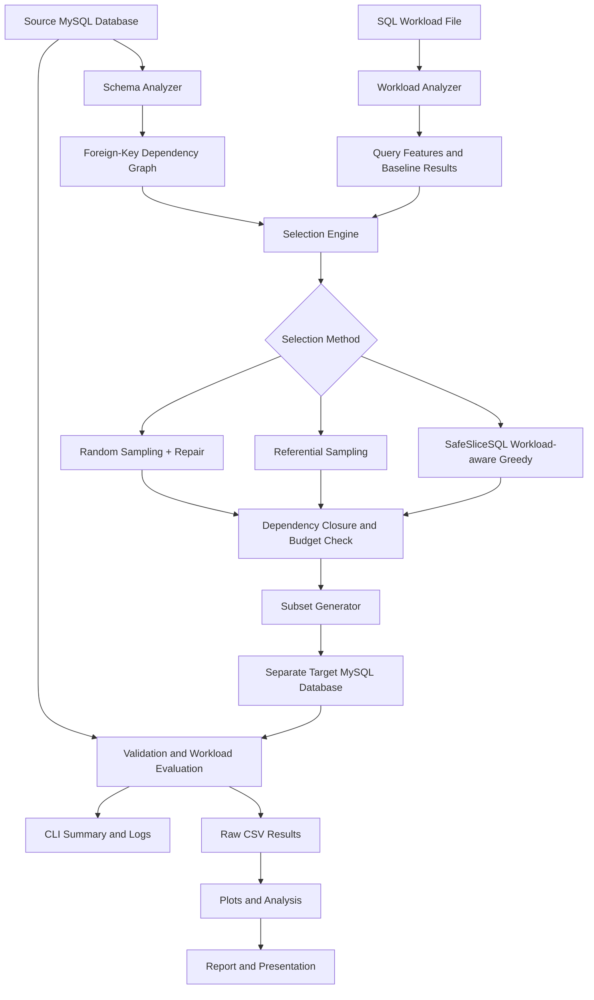

# SafeSliceSQL

SafeSliceSQL is a workload-aware database subsetting system for MySQL. It creates smaller, valid relational subsets while preserving referential integrity and retaining as much workload behavior as possible under a hard row budget.

The system compares a proposed workload-aware greedy selector against baseline sampling methods: random sampling with dependency repair and referential/table-aware sampling.

## Project Goals

- Reduce database size while preserving schema and dependency correctness
- Keep a strict hard row budget
- Maintain referential integrity across parent-child relationships
- Preserve behavior for a declared SQL workload
- Provide reproducible baseline and proposed-method comparisons
- Support benchmarking, validation, and result reporting

## Architecture Overview



## Core Components

- config.py: environment and database configuration
- db.py: database connection and health checks
- schema_analyzer.py: source schema introspection
- dependency_graph.py: foreign-key dependency graph and closure logic
- subset_generator.py: target database creation and row insertion
- workload_analyzer.py: SQL workload parsing and feature extraction
- sampler.py: baseline and workload-aware row-selection methods
- validator.py: subset validation and workload evaluation
- benchmark.py: benchmark orchestration and experiment runs
- cli.py: command-line interface
- reporting.py: reporting and output formatting

## Supported Scope

SafeSliceSQL currently supports:

- MySQL 8.x with InnoDB
- Single-column and composite primary keys
- Single-column foreign keys in acyclic graphs
- Nullable foreign keys treated as "no dependency"
- SELECT workloads with WHERE, JOIN, GROUP BY, and basic aggregates
- Fixed workload files and reproducible seeds
- Hard row budgets

Current limitations:

- Composite foreign keys
- Cyclic foreign-key graphs
- OUTER JOINs
- Subqueries and CTEs
- DML operations
- Soft budgets and per-table budgets

## Project Workflow

1. Load configuration from environment variables
2. Inspect the source schema and dependency graph
3. Parse the workload file and extract query features
4. Select rows using a chosen method
5. Enforce dependency-closure and row-budget constraints
6. Materialize the subset into a target database
7. Validate the subset for schema and integrity correctness
8. Execute the workload on source and target databases
9. Compare outcomes and generate benchmark/report outputs

## Data Flow

1. Configure the environment
2. Inspect the source schema
3. Analyze the declared workload
4. Build the dependency graph
5. Apply a selection strategy
6. Generate the subset
7. Validate target data integrity
8. Evaluate workload retention metrics
9. Report results and benchmark comparisons

## Installation

### Windows setup

Run these commands from the repository root in Command Prompt:

```cmd
py -3.13 -m venv .venv
call .venv\Scripts\activate.bat
python -m pip install --upgrade pip
python -m pip install -r requirements.txt
python -m pip install -e .
if not exist .env copy .env.example .env
notepad .env
```

The `requirements.txt` file includes both application dependencies and test/lint tools. SQLAlchemy is installed by the `sqlalchemy` package; `python-dotenv` provides `from dotenv import load_dotenv`.

### Configure MySQL

Edit the local `.env` file. Set the host, port, username, password, and database names to match your MySQL installation. The source and target must be different databases:

```dotenv
SAFESLICE_SOURCE_HOST=localhost
SAFESLICE_SOURCE_PORT=3306
SAFESLICE_SOURCE_USER=root
SAFESLICE_SOURCE_PASSWORD=your_local_mysql_password
SAFESLICE_SOURCE_DATABASE=employees

SAFESLICE_TARGET_HOST=localhost
SAFESLICE_TARGET_PORT=3306
SAFESLICE_TARGET_USER=root
SAFESLICE_TARGET_PASSWORD=your_local_mysql_password
SAFESLICE_TARGET_DATABASE=employees_slice

SAFESLICE_LOG_LEVEL=INFO
SAFESLICE_LOG_DIR=logs
```

Use your own credentials in `.env`; do not put real passwords in source files or commit `.env`. The source account should have read access. The target account needs permission to create and replace tables and insert selected rows. If a password contains `#` or whitespace, quote its value in `.env`.

Create the source database by loading a MySQL sample database if it is not already present. SafeSliceSQL does not download or load the Employees sample dataset for you. Verify it and create the target database in MySQL:

```cmd
mysql -h localhost -P 3306 -u root -p
```

At the MySQL prompt:

```sql
SHOW DATABASES;
CREATE DATABASE IF NOT EXISTS employees_random_slice;
CREATE DATABASE IF NOT EXISTS employees_referential_slice;
CREATE DATABASE IF NOT EXISTS employees_workload_slice;
CREATE DATABASE IF NOT EXISTS employees_benchmark_slice;
EXIT;
```

Set `SAFESLICE_TARGET_DATABASE` to the target you intend to use, or pass a target with `--target`. The `run` command tests the target connection before materialization, so each target database must exist and be accessible before starting a run. The benchmark uses the target database configured in `.env` unless explicit database URLs are supplied.

### Verify the connection

With `.venv` activated and `.env` configured, inspect the source database:

```cmd
python -m safeslicesql.cli inspect --database employees
```

This checks the source connection and prints the discovered tables, primary keys, foreign-key relationships, and dependency order. It does not create or modify the target database. `python -m safeslicesql.cli` runs the package from the active environment; the installed `safeslice` command is also available after `pip install -e .`.

## Example Commands

```bash
python -m safeslicesql.cli inspect --database employees
python -m safeslicesql.cli run --method random-repair --budget-percent 20 --seed 42 --source employees --target employees_random_slice --output-dir results\random-repair
python -m safeslicesql.cli run --method referential --budget-percent 20 --seed 42 --source employees --target employees_referential_slice --output-dir results\referential
python -m safeslicesql.cli run --method workload-aware --budget-percent 20 --seed 42 --source employees --target employees_workload_slice --output-dir results\workload-aware
python -m safeslicesql.cli validate --source employees --target employees_random_slice
```

Create each target database in MySQL before running its corresponding method. Materialization recreates tables in the specified target, so use a dedicated target database for each method. Run output directories are created automatically and contain CSV run metrics; they are not SQL database dumps. To export a target database as a SQL dump, use MySQL's `mysqldump` command separately.

The Employees sample contains composite primary keys. These are supported and represented internally as tuples in primary-key column order. Composite foreign keys and cyclic foreign-key graphs remain unsupported. Candidate selection scans source primary keys to build a seeded reservoir, so even a small row budget can take time on multi-million-row databases.

## Workload Model

The workload is a fixed SQL workload file stored in the workloads directory. Each query is parsed for:

- tables referenced
- join relationships
- filter columns
- grouping columns
- aggregate functions
- supported vs unsupported pattern classification

This enables the workload-aware heuristic to prioritize candidate rows that are more valuable for the declared workload while respecting dependency cost.

## Selection Methods

### Random Sampling with Repair

- Randomly selects seed rows
- Expands with dependency closure
- Rejects candidates that violate the hard budget
- Provides a reproducible baseline

### Referential Sampling

- Uses relationship-aware table ordering and dependency closure
- Prefers parent/child-connected rows in a reproducible way
- Maintains the same budget enforcement as the random baseline

### Workload-aware Greedy Selection

Uses a score function of the form:

```text
score(c | S) = ΔV(c | S) / max(1, ΔD(c | S))
```

Where:

- ΔV(c | S) is the marginal workload-retention value of candidate c
- ΔD(c | S) is the additional dependency cost required to include c

This provides a transparent heuristic for balancing workload relevance against dependency expansion.

## Validation and Evaluation

SafeSliceSQL validates:

- table presence
- primary-key uniqueness
- foreign-key integrity
- budget compliance
- schema compatibility
- source immutability assumptions

It then executes the declared workload on both source and target databases and compares metrics such as:

- query survival
- result-row retention
- key retention
- aggregate retention
- supported vs unsupported query accounting

## Benchmarking

The project includes a benchmark path for comparing selection methods across:

- row budgets
- seeds
- dataset sizes
- method variants

Benchmark results are stored in a structured form for later analysis and comparison.

The checked-in `benchmarks/benchmarks.yaml` is configured with SQLite example URLs. For MySQL, use a copy of the YAML with its SQLite `database:` URLs removed so the benchmark uses the source and target settings from `.env`. Set its output paths to locations under `results/`, then run:

```cmd
python -m safeslicesql.cli benchmark --config benchmarks\benchmarks_mysql.yaml
```

The benchmark reuses and recreates tables in its configured target database across experiments. Its raw run CSVs, summary CSV/Markdown files, and plots are written to the configured raw, summary, and plot directories.

## Repository Layout

```text
SafeSliceSQL/
├── docs/
│   ├── algorithm.md
│   ├── architecture.md
│   ├── demo_script.md
│   ├── limitations.md
│   └── metrics.md
├── src/
│   └── safeslicesql/
├── tests/
├── workloads/
├── README.md
├── requirements.txt
├── SafeSliceSQL_Complete_Project_Architecture_and_Phases.md
├── pyproject.toml
└── .gitignore
```

## Notes

This README reflects the project architecture as implemented and described in the project documentation, assuming all planned phases are completed. It is intended to provide a complete project-level overview for setup, execution, and understanding.

## License

This project is intended for research and academic use within the SafeSliceSQL workflow. Specific license terms should be added according to the repository owner’s policy.
