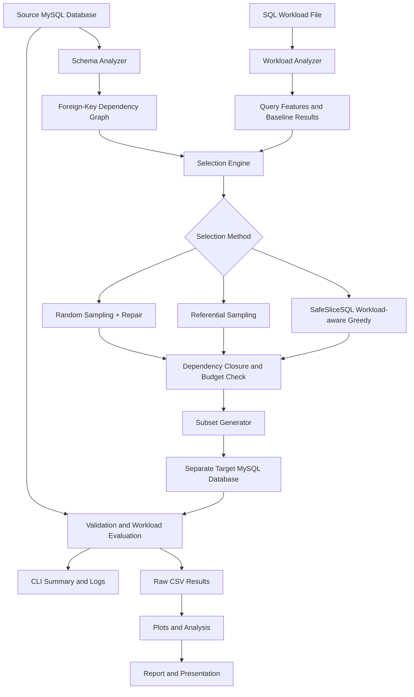

# SafeSliceSQL

SafeSliceSQL is a workload-aware database subsetting system for MySQL. It creates smaller, valid relational subsets while preserving referential integrity and retaining as much workload behavior as possible under a hard row budget.

The system compares a proposed workload-aware greedy selector against baseline sampling methods: random sampling with dependency repair and referential/table-aware sampling.

## Project Goals

- Reduce database size while preserving schema and dependency correctness
- Keep a strict hard row budget
- Maintain referential integrity across parent-child relationships
- Preserve behavior for a declared SQL workload
- Provide reproducible baseline and proposed-method comparisons
- Support benchmarking, validation, and result reporting

## Architecture Overview



## Core Components

- config.py: environment and database configuration
- db.py: database connection and health checks
- schema_analyzer.py: source schema introspection
- dependency_graph.py: foreign-key dependency graph and closure logic
- subset_generator.py: target database creation and row insertion
- workload_analyzer.py: SQL workload parsing and feature extraction
- sampler.py: baseline and workload-aware row-selection methods
- validator.py: subset validation and workload evaluation
- benchmark.py: benchmark orchestration and experiment runs
- cli.py: command-line interface
- reporting.py: reporting and output formatting

## Supported Scope

SafeSliceSQL currently supports:

- MySQL 8.x with InnoDB
- Single-column and composite primary keys
- Single-column foreign keys in acyclic table dependencies; self-referencing tables with acyclic row dependencies
- Nullable foreign keys treated as "no dependency"
- SELECT workloads with WHERE, JOIN, GROUP BY, and basic aggregates
- Fixed workload files and reproducible seeds
- Hard row budgets

Current limitations:

- Composite foreign keys
- Cyclic foreign-key graphs
- OUTER JOINs
- Subqueries and CTEs
- DML operations
- Soft budgets and per-table budgets

## Project Workflow

1. Load configuration from environment variables
2. Inspect the source schema and dependency graph
3. Parse the workload file and extract query features
4. Select rows using a chosen method
5. Enforce dependency-closure and row-budget constraints
6. Materialize the subset into a target database
7. Validate the subset for schema and integrity correctness
8. Execute the workload on source and target databases
9. Compare outcomes and generate benchmark/report outputs

## Data Flow

1. Configure the environment
2. Inspect the source schema
3. Analyze the declared workload
4. Build the dependency graph
5. Apply a selection strategy
6. Generate the subset
7. Validate target data integrity
8. Evaluate workload retention metrics
9. Report results and benchmark comparisons

## Installation

### Windows setup

Run these commands from the repository root in Command Prompt:

```cmd
py -3.13 -m venv .venv
call .venv\Scripts\activate.bat
python -m pip install --upgrade pip
python -m pip install -r requirements.txt
python -m pip install -e .
if not exist .env copy .env.example .env
notepad .env
```

The `requirements.txt` file includes both application dependencies and test/lint tools. SQLAlchemy is installed by the `sqlalchemy` package; `python-dotenv` provides `from dotenv import load_dotenv`.

### Configure MySQL

Edit the local `.env` file. Set the host, port, username, password, and database names to match your MySQL installation. The source and target must be different databases:

```dotenv
SAFESLICE_SOURCE_HOST=localhost
SAFESLICE_SOURCE_PORT=3306
SAFESLICE_SOURCE_USER=root
SAFESLICE_SOURCE_PASSWORD=your_local_mysql_password
SAFESLICE_SOURCE_DATABASE=employees

SAFESLICE_TARGET_HOST=localhost
SAFESLICE_TARGET_PORT=3306
SAFESLICE_TARGET_USER=root
SAFESLICE_TARGET_PASSWORD=your_local_mysql_password
SAFESLICE_TARGET_DATABASE=employees_slice

SAFESLICE_LOG_LEVEL=INFO
SAFESLICE_LOG_DIR=logs
```

Use your own credentials in `.env`; do not put real passwords in source files or commit `.env`. The source account should have read access. The target account needs permission to create tables and delete/insert target rows (plus DROP to clean up newly created tables after a failed attempt). If a password contains `#` or whitespace, quote its value in `.env`.

Create the source database by loading a MySQL sample database if it is not already present. SafeSliceSQL does not download or load the Employees sample dataset for you. Verify it and create the target database in MySQL:

```cmd
mysql -h localhost -P 3306 -u root -p
```

At the MySQL prompt:

```sql
SHOW DATABASES;
CREATE DATABASE IF NOT EXISTS employees_random_slice;
CREATE DATABASE IF NOT EXISTS employees_referential_slice;
CREATE DATABASE IF NOT EXISTS employees_workload_slice;
CREATE DATABASE IF NOT EXISTS employees_benchmark_slice;
EXIT;
```

Set `SAFESLICE_TARGET_DATABASE` to the target you intend to use, or pass a target with `--target`. The `run` command tests the target connection before materialization, so each target database must exist and be accessible before starting a run. The benchmark uses the target database configured in `.env` unless explicit database URLs are supplied.

### Verify the connection

With `.venv` activated and `.env` configured, inspect the source database:

```cmd
python -m safeslicesql.cli inspect --database employees
```

This checks the source connection and prints the discovered tables, primary keys, foreign-key relationships, and dependency order. It does not create or modify the target database. `python -m safeslicesql.cli` runs the package from the active environment; the installed `safeslice` command is also available after `pip install -e .`.

## Example Commands

For the guided desktop interface, double-click **`demo.bat`**. Choose the data
type, select a file/folder or find a MySQL database, move the percentage slider,
and click **Create smaller copy**. Results show row counts and plain-language
checks, with buttons for reports and charts. Work runs in the background so the
window remains responsive; closing is blocked while a copy is in progress.
Every action prepares a fresh target database. Comparison mode, method/seed
controls, and session-only connection settings are under **Advanced options**.
File imports still require the configured MySQL target server. No database
password is written into result reports or run YAML files.

The terminal interface is also available through **`Terminal Demo.bat`** or
`safeslice demo`. For faculty-supplied data there, choose **9 — Load a faculty dataset**.
Choose an existing MySQL database, a UTF-8 CSV file/folder, or an Excel `.xlsx`
workbook. Existing databases are displayed as numbered choices. CSV/Excel input
opens a native file/folder picker, so no full path needs to be typed. Cancel
returns to the menu without changing the active dataset. CSV files and worksheets use the first row as column headers. MySQL
connections come from `.env`; existing sources use source credentials, while file
imports and newly created targets use target credentials. The target account
needs CREATE/DROP DATABASE privileges for preparation and failure cleanup.

Preparation discovers the schema, creates a new UUID-named target, and generates
queries from its actual tables and declared foreign keys. Choose **3** to preview,
**4** to generate/validate a subset, or **5** to compare methods. No World-specific
workload or command edits are needed. Unsupported existing schemas are diagnosed
before target creation. Existing source databases are read only.

Each CSV or worksheet becomes a separate table. File values are stored as text
so identifiers such as `001` remain intact. An added `_safeslice_id` identifies
rows; colliding or duplicate headers are renamed with mappings recorded in
`results/datasets/.../dataset.json`. Foreign keys and numeric/date types are not
inferred from files. Use an existing relational MySQL database to demonstrate
declared relationship preservation. Formulas in Excel are imported as text,
without evaluation. Install Excel support with `pip install -e ".[excel]"`
(also included in `requirements.txt`). Legacy `.xls` files must be saved as `.xlsx`.

Imported sources and prepared targets remain on MySQL for the demonstration,
using names shown in the menu and manifest. Failed preparation removes only
databases it created and leaves the active demo settings unchanged. Generated
queries measure structural coverage, not inferred business intent. If faculty
supplies business SQL, choose **2** to set that workload file instead. Existing
CLI runs and benchmark configurations also accept `auto` as the workload path.

To check multiple generated databases, choose **8** in the demo menu, or run
`safeslice selftest`. The default runs 30 checks across five schema shapes, all
three selection methods, and budgets of 10% and 100%. SQLite is the default and
does not require a MySQL connection. Each schema gets matching generated SQL.
The checks cover table/row-count variation, skewed values and relationships,
nullable foreign keys, composite primary keys, empty tables, source preservation,
same-seed replay, target refresh, integrity, and full-copy result equality.

For larger checks, run `safeslice selftest --cases 10 --rows 10000 --seed 123`.
`--rows` is the maximum rows per generated table, not total database size.
Different seeds change names, row counts, relationships, and values. The five
supported topology families repeat when more than five cases are requested.
Reports, manifests, generated workloads, and SQLite files are saved in a new
`results/selftest/` directory for each invocation; results are never overwritten.

Use `safeslice selftest --mysql` to test MySQL itself with the **target server's
credentials from `.env`**. That account needs CREATE/DROP DATABASE privileges.
This creates UUID-named `safeslice_check_*` source/target schemas and deletes only
schemas created by that invocation, including after failures. It does not use
your configured source or target database for test data. Keep this on a test
server when increasing scale. SQLite files remain available for investigation;
MySQL schemas are disposable, with manifests/workloads/reports retained locally.

Pass/fail covers correctness and repeatability; retention at partial budgets is
reported as a quality metric, not a guarantee of query survival. Generated tests
do not establish production readiness or support for arbitrary schemas. MySQL 8
InnoDB, supported FK structures, and supported SQL patterns remain the scope.
For real databases, use demo option **2** to change the source, dedicated target,
and matching workload together, then inspect/preview/run. Workloads for `world`
cannot be reused unchanged on unrelated tables. Representative large datasets,
concurrent activity, permissions, and resource limits need separate evaluation.

For a terminal presentation, double-click `Terminal Demo.bat` in the project folder. The equivalent installed command is
`safeslice demo`. It opens a numbered terminal menu: inspect the source, change
method/budget/seed/database/workload, preview selection, generate and validate a
subset, compare all three methods, review per-query results, or open charts.
Press Enter at a settings prompt to keep its current value. The menu remains
open between actions, including failed actions.

The menu reads credentials from `.env`. Create the dedicated target database
before generating a subset; generation and comparison refresh that target's
contents. Comparison uses the currently selected budget and seed for all three
methods. Each action saves reports under a separate `results/demo/` subfolder.
For a short faculty demo, choose **1** to inspect, **3** to preview, **4** to
generate, **2** to change the budget, **5** to compare, and **7** to open charts.

```bash
python -m safeslicesql.cli inspect --database employees
python -m safeslicesql.cli run --method random-repair --budget-percent 20 --seed 42 --source employees --target employees_random_slice --output-dir results\random-repair
python -m safeslicesql.cli run --method referential --budget-percent 20 --seed 42 --source employees --target employees_referential_slice --output-dir results\referential
python -m safeslicesql.cli run --method workload-aware --budget-percent 20 --seed 42 --source employees --target employees_workload_slice --output-dir results\workload-aware
python -m safeslicesql.cli validate --source employees --target employees_random_slice
```

Create each target database in MySQL before running its corresponding method. Materialization transactionally refreshes rows in compatible target tables, so use a dedicated target database for each method. Run output directories are created automatically and contain CSV run metrics; they are not SQL database dumps. To export a target database as a SQL dump, use MySQL's `mysqldump` command separately.

The Employees sample contains composite primary keys. These are supported and represented internally as tuples in primary-key column order. Composite foreign keys and cyclic foreign-key graphs remain unsupported. Candidate selection scans source primary keys to build a seeded reservoir, so even a small row budget can take time on multi-million-row databases.

## Materialization safety

The connected source and target databases must be distinct. MySQL identity checks use the server UUID and connected database, so host aliases and misleading target names cannot bypass the guard. Explicit MySQL target names must match the target connection.

Existing target tables must match the source column definitions, primary and foreign keys, unique constraints, and check constraints. Incompatible schemas or failed reflection abort the run; SafeSliceSQL does not guess replacement types or drop existing tables. Use a separate empty target when changing the source schema.

Compatible targets are refreshed using child-first DELETEs and parent-first INSERTs in one transaction. Self-referencing tables are ordered by their actual row dependencies for both deletion and insertion; cyclic rows or omitted required parents abort the copy and roll back. A failed copy rolls back to the previous target rows. MySQL tables must use InnoDB. Missing tables are created before the copy; cleanup after failure only drops tables created by that attempt. Failure to clean up is logged. Workload statements classified as unsupported are never executed. Every source table must have a declared primary key. Selected keys must be unique, and every selected row must exist when copied. Budgets must be non-negative integers (zero permits only an empty subset), and the actual target row count is checked before commit. Generated columns are computed by the target and are omitted from INSERT payloads.

## Workload Model

The workload is a fixed SQL workload file stored in the workloads directory. Statement splitting respects quoted strings, escaped quotes, and quoted identifiers. Standard SQL block comments, MySQL-style `-- ` comments, and `#` comments are removed without changing following clauses; executable comments and unterminated quotes/comments are rejected. The lexer assumes MySQL backslash-escape rules. Database-qualified workload table names are excluded so target evaluation cannot accidentally query a named source database. Each query is parsed for:

- tables referenced
- join relationships
- filter columns
- grouping columns
- aggregate functions
- supported vs unsupported pattern classification

This enables the workload-aware heuristic to prioritize candidate rows that are more valuable for the declared workload while respecting dependency cost.

## Selection Methods

### Random Sampling with Repair

- Randomly selects seed rows
- Expands with dependency closure
- Rejects candidates that violate the hard budget
- Provides a reproducible baseline

### Referential Sampling

- Uses relationship-aware table ordering and dependency closure
- Prefers parent/child-connected rows in a reproducible way
- Maintains the same budget enforcement as the random baseline

### Workload-aware Greedy Selection

The current implementation builds workload-related table weights from supported query features, then scores candidate rows using the table weight divided by the candidate's standalone dependency-closure size. During selection it checks incremental closure cost against already selected rows. This is a heuristic; it is not an exact row-level marginal query-result calculation.

```text
score(candidate) = workload_table_weight / max(1, standalone_dependency_closure_rows)
```

This provides a transparent heuristic for balancing workload-relevant tables against dependency expansion. It does not guarantee a globally optimal subset.

## Validation and Evaluation

SafeSliceSQL validates:

- table presence
- primary-key uniqueness
- foreign-key integrity
- budget compliance
- schema compatibility
- source content/schema fingerprints for runs and benchmarks; standalone validation without a prior snapshot reports immutability as unverified

It then executes the declared workload on both source and target databases and compares metrics such as:

- query survival
- result-row retention
- key retention
- aggregate retention
- supported vs unsupported query accounting

## Benchmarking

The project includes a benchmark path for comparing selection methods across:

- row budgets
- seeds
- dataset sizes
- method variants

Benchmark results are stored in a structured form for later analysis and comparison.

The checked-in `benchmarks/benchmarks.yaml` is configured with SQLite example URLs. For MySQL, use a copy of the YAML with its SQLite `database:` URLs removed so the benchmark uses the source and target settings from `.env`. Set its output paths to locations under `results/`, then run:

```cmd
python -m safeslicesql.cli benchmark --config benchmarks\benchmarks_mysql.yaml
```

The benchmark reuses compatible tables and transactionally refreshes their rows in its configured target database across experiments. Its raw run CSVs, summary CSV/Markdown files, and plots are written to the configured raw, summary, and plot directories.

## Complete setup and 1% experiment reproduction (Windows)

This guide reproduces the three implemented methods against the MySQL Employees sample database. Commands marked **PowerShell** belong in the VS Code terminal; commands marked **MySQL SQL** belong in MySQL Workbench or a MySQL client. Do not paste SQL statements into PowerShell.

### Experiment configuration

| Setting | Value |
|---|---|
| Project directory | `C:\safeslicesql` |
| Python environment | `env` (if created with this name) |
| Python version | `>=3.10` (as declared in `pyproject.toml`) |
| MySQL host / port | `localhost` / `3306` |
| MySQL user | `root` in the local example; change if needed |
| Source database | `employees` |
| Budget / seed | `1%` / `42` |
| Methods | `random-repair`, `referential`, `workload-aware` |

The 1% budget is calculated from the **total rows across all source tables**, not 1% of the `employees` table alone. In the recorded run the source contained 3,919,015 total rows, giving a 39,190-row budget. Dependency rows are included in this total.

### 1. Open the repository and activate the virtual environment

**PowerShell — VS Code terminal:**

```powershell
cd C:\safeslicesql
code .
```

Open a PowerShell integrated terminal. If your virtual environment is named `env`, activate it:

```powershell
.\env\Scripts\Activate.ps1
```

If PowerShell blocks activation, allow scripts for this process only and retry:

```powershell
Set-ExecutionPolicy -Scope Process -ExecutionPolicy Bypass
.\env\Scripts\Activate.ps1
```

Check the active interpreter. Python 3.10 or newer is supported; the interpreter path should point into this repository's `env` directory when using that environment.

```powershell
python --version
python -c "import sys; print(sys.executable)"
```

### 2. Install and check SafeSliceSQL

**PowerShell:**

```powershell
python -m pip install --upgrade pip
python -m pip install -r requirements.txt
python -m pip install -e .
python -c "import safeslicesql; print('SafeSliceSQL imported successfully')"
python -m safeslicesql.cli --help
python -m safeslicesql.cli run --help
```

The run command accepts these method names: `random-repair`, `referential`, and `workload-aware`. The workload option is `--workload` and defaults to `workloads/workload.sql`.

### 3. Check MySQL and the Employees source database

Connect to your local server in **MySQL Workbench** (host `localhost`, port `3306`) and execute the following in a SQL Editor tab:

```sql
SELECT USER();
SELECT CURRENT_USER();
SHOW DATABASES LIKE 'employees';
```

Confirm that `employees` is the Employees sample database and contains the expected six tables:

```sql
USE employees;
SHOW TABLES;
SELECT COUNT(*) AS employee_rows FROM employees;
```

The standard Employees sample database has 300,024 rows in `employees`. SafeSliceSQL's row-budget percentage is based on the **sum across all tables**, so it is not calculated from this count alone.

### 4. Create the three target schemas

Run in **MySQL Workbench SQL Editor** (or another connected MySQL SQL client):

```sql
CREATE DATABASE IF NOT EXISTS employees_random_1pct;
CREATE DATABASE IF NOT EXISTS employees_referential_1pct;
CREATE DATABASE IF NOT EXISTS employees_workload_1pct;

SHOW DATABASES LIKE 'employees%1pct';
```

These are destination schemas, not files. SafeSliceSQL creates missing target tables and refreshes rows in compatible existing tables during materialization. Use dedicated targets and do not store data there that you need to keep. The SQL statements above do not drop existing databases.

### 5. Configure the local `.env`

In the repository root, copy `.env.example` to `.env` if `.env` does not already exist. Edit `.env` and set the source and target hosts, ports, users, passwords, and database names using the variable names shown in `.env.example`. For the current project example:

```dotenv
SAFESLICE_SOURCE_HOST=localhost
SAFESLICE_SOURCE_PORT=3306
SAFESLICE_SOURCE_USER=root
SAFESLICE_SOURCE_PASSWORD=your_local_mysql_password
SAFESLICE_SOURCE_DATABASE=employees

SAFESLICE_TARGET_HOST=localhost
SAFESLICE_TARGET_PORT=3306
SAFESLICE_TARGET_USER=root
SAFESLICE_TARGET_PASSWORD=your_local_mysql_password
SAFESLICE_TARGET_DATABASE=employees_workload_1pct
```

Replace the example password with your local MySQL password; do not commit or share `.env`. `.gitignore` ignores `.env`. The commands below pass an explicit `--target` for each method, so the configured default target is overridden per run. The account needs read access to the source and permission to create tables and delete/insert target rows. Check the connection and schema before running experiments:

```powershell
python -m safeslicesql.cli inspect --database employees
```

Proceed only if the source connection succeeds and the schema is supported. If authentication unexpectedly uses stale values from the current PowerShell process, inspect and clear any `SAFESLICE_*` environment-variable overrides before retrying; `.env` loading does not override existing process environment variables.

### 6. Run the three algorithms

Run these commands separately in **PowerShell**, from `C:\safeslicesql`. Each uses the same source, 1% total-row budget, seed, and default workload, while writing to its own MySQL target and CSV-results directory.

**Algorithm 1 — Random sampling with dependency repair:**

```powershell
python -m safeslicesql.cli run --method random-repair --budget-percent 1 --seed 42 --source employees --target employees_random_1pct --output-dir results/1pct/random-repair
```

**Algorithm 2 — Referential/table-aware sampling:**

```powershell
python -m safeslicesql.cli run --method referential --budget-percent 1 --seed 42 --source employees --target employees_referential_1pct --output-dir results/1pct/referential
```

**Algorithm 3 — Workload-aware greedy selection:**

```powershell
python -m safeslicesql.cli run --method workload-aware --budget-percent 1 --seed 42 --source employees --target employees_workload_1pct --output-dir results/1pct/workload-aware
```

Wait for each command to finish and check its **Subset Validation Summary** and **Workload Evaluation Summary**. Dependency-closure rows count toward the hard budget, so a subset may use less than the full limit if another candidate and its required parents do not fit. Rerunning a method replaces rows in its target database; do not point it at a database with data you need to preserve.

### 7. Verify target databases and saved results

**MySQL Workbench SQL Editor — list targets and tables:**

```sql
SHOW DATABASES LIKE 'employees%1pct';

SELECT table_schema, table_name, table_rows
FROM information_schema.tables
WHERE table_schema IN (
  'employees_random_1pct',
  'employees_referential_1pct',
  'employees_workload_1pct'
)
ORDER BY table_schema, table_name;
```

The database contents are stored and managed by MySQL Server, not as standalone `.sql` or `.db` files in this repository. The results CSVs are saved under `results/1pct/`. List them in **PowerShell**:

```powershell
Get-ChildItem .\results\1pct -Recurse
explorer .\results\1pct
```

Each CLI run emits a CSV path; use the generated CSV and console metrics as the source of experimental values. Do not fill comparison tables with estimates.

### 8. Interpret the workload metrics

The default `workloads/workload.sql` contains eight queries, identified in order as Q1–Q8. In the run output, **Survived = YES** means the query returns at least one row on both source and subset. The summary survival rate divides survived queries by eligible source queries: confirmed source-empty queries such as Q8 are excluded, while execution failures with unknown source results count as failures. The output shows the denominator and failure counts.

- **Key Ret.**: fraction of source result keys found in target results (based on columns recognized as keys; otherwise falls back to exact row overlap).
- **Row Ret.**: fraction of source result rows retained using multiset overlap, so duplicate tuples count correctly and repeated output column names preserve every position.
- **Agg Ret.**: for grouped queries with resolvable projected grouping keys, this measures grouping-key survival, including aliased outputs. Scalar aggregates and unresolved grouping projections fall back to exact result-row retention; this is not a general numerical aggregate-accuracy metric.
- **Q8:** both source and target are empty, so it reports `Survived = NO`; retention metrics remain 100% for this empty/empty case, and Q8 is excluded from the survival denominator. Mention this metric caveat when presenting averages.

The following recorded single-seed figures use the previous validation and metric definitions and must be regenerated for comparison with current runs. In that historical run, all three methods passed hard-budget, primary-key, foreign-key, schema-compatibility, and source-unchanged validation. At 1% and seed 42, the log reported survival rates of 75.0% (random-repair), 62.5% (referential), and 75.0% (workload-aware); workload-aware had slightly higher reported overall key/row/aggregate retention. These observations describe only this dataset, workload, budget, and seed; repeat with additional seeds before claiming a general algorithmic advantage. See [`technical_report.md`](technical_report.md) for per-query results and metric definitions.

### Troubleshooting

| Problem | Check |
|---|---|
| `mysql` is not recognized | Use MySQL Workbench or add the MySQL client executable to PATH. |
| Connection refused | Confirm the MySQL service is running and host/port match `.env`. |
| MySQL access denied (1045) | Check username/password and clear stale `SAFESLICE_*` PowerShell environment-variable overrides. |
| Python module not found | Activate the intended virtual environment and run `python -m pip install -e .`. |
| `CREATE` is not recognized | SQL was entered in PowerShell; execute it in MySQL Workbench's SQL Editor. |
| Target already contains tables | Confirm the target is dedicated to this experiment; materialization may refresh its tables. |
| CLI method rejected | Run `python -m safeslicesql.cli run --help` and use one of the supported method names above. |

## Repository Layout

```text
SafeSliceSQL/
├── docs/
│   ├── algorithm.md
│   ├── architecture.md
│   ├── demo_script.md
│   ├── limitations.md
│   └── metrics.md
├── src/
│   └── safeslicesql/
├── tests/
├── workloads/
├── README.md
├── requirements.txt
├── SafeSliceSQL_Complete_Project_Architecture_and_Phases.md
├── pyproject.toml
└── .gitignore
```

## Notes

This README reflects the project architecture as implemented and described in the project documentation, assuming all planned phases are completed. It is intended to provide a complete project-level overview for setup, execution, and understanding.

## License

This project is intended for research and academic use within the SafeSliceSQL workflow. Specific license terms should be added according to the repository owner’s policy.
