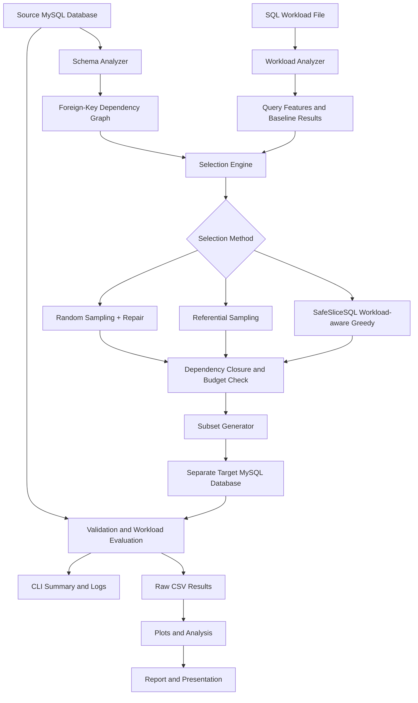

# SafeSliceSQL

SafeSliceSQL is a workload-aware database subsetting system for MySQL. It creates smaller, valid relational subsets while preserving referential integrity and retaining as much workload behavior as possible under a hard row budget.

The system compares a proposed workload-aware greedy selector against baseline sampling methods: random sampling with dependency repair and referential/table-aware sampling.

## Project Goals

- Reduce database size while preserving schema and dependency correctness
- Keep a strict hard row budget
- Maintain referential integrity across parent-child relationships
- Preserve behavior for a declared SQL workload
- Provide reproducible baseline and proposed-method comparisons
- Support benchmarking, validation, and result reporting

## Architecture Overview



## Core Components

- config.py: environment and database configuration
- db.py: database connection and health checks
- schema_analyzer.py: source schema introspection
- dependency_graph.py: foreign-key dependency graph and closure logic
- subset_generator.py: target database creation and row insertion
- workload_analyzer.py: SQL workload parsing and feature extraction
- sampler.py: baseline and workload-aware row-selection methods
- validator.py: subset validation and workload evaluation
- benchmark.py: benchmark orchestration and experiment runs
- cli.py: command-line interface
- reporting.py: reporting and output formatting

## Supported Scope

SafeSliceSQL v1 supports:

- MySQL 8.x with InnoDB
- Single-column primary keys
- Single-column foreign keys in acyclic graphs
- Nullable foreign keys treated as "no dependency"
- SELECT workloads with WHERE, JOIN, GROUP BY, and basic aggregates
- Fixed workload files and reproducible seeds
- Hard row budgets

Unsupported in v1:

- Composite primary keys
- Composite foreign keys
- Cyclic foreign-key graphs
- OUTER JOINs
- Subqueries and CTEs
- DML operations
- Soft budgets and per-table budgets

## Project Workflow

1. Load configuration from environment variables
2. Inspect the source schema and dependency graph
3. Parse the workload file and extract query features
4. Select rows using a chosen method
5. Enforce dependency-closure and row-budget constraints
6. Materialize the subset into a target database
7. Validate the subset for schema and integrity correctness
8. Execute the workload on source and target databases
9. Compare outcomes and generate benchmark/report outputs

## Data Flow

1. Configure the environment
2. Inspect the source schema
3. Analyze the declared workload
4. Build the dependency graph
5. Apply a selection strategy
6. Generate the subset
7. Validate target data integrity
8. Evaluate workload retention metrics
9. Report results and benchmark comparisons

## Installation

Clone the project and install dependencies from the root directory:

```bash
pip install -r requirements.txt
```

For local development and testing, the same requirements file includes the dev tooling as well.

## Example Commands

```bash
safeslice inspect --database employees_source
safeslice run --method random-repair --budget-percent 20 --seed 42
safeslice run --method referential --budget-percent 20 --seed 42
safeslice run --method workload-aware --budget-percent 20 --seed 42
safeslice validate --source employees_source --target employees_slice
```

## Workload Model

The workload is a fixed SQL workload file stored in the workloads directory. Each query is parsed for:

- tables referenced
- join relationships
- filter columns
- grouping columns
- aggregate functions
- supported vs unsupported pattern classification

This enables the workload-aware heuristic to prioritize candidate rows that are more valuable for the declared workload while respecting dependency cost.

## Selection Methods

### Random Sampling with Repair

- Randomly selects seed rows
- Expands with dependency closure
- Rejects candidates that violate the hard budget
- Provides a reproducible baseline

### Referential Sampling

- Uses relationship-aware table ordering and dependency closure
- Prefers parent/child-connected rows in a reproducible way
- Maintains the same budget enforcement as the random baseline

### Workload-aware Greedy Selection

Uses a score function of the form:

```text
score(c | S) = ΔV(c | S) / max(1, ΔD(c | S))
```

Where:

- ΔV(c | S) is the marginal workload-retention value of candidate c
- ΔD(c | S) is the additional dependency cost required to include c

This provides a transparent heuristic for balancing workload relevance against dependency expansion.

## Validation and Evaluation

SafeSliceSQL validates:

- table presence
- primary-key uniqueness
- foreign-key integrity
- budget compliance
- schema compatibility
- source immutability assumptions

It then executes the declared workload on both source and target databases and compares metrics such as:

- query survival
- result-row retention
- key retention
- aggregate retention
- supported vs unsupported query accounting

## Benchmarking

The project includes a benchmark path for comparing selection methods across:

- row budgets
- seeds
- dataset sizes
- method variants

Benchmark results are stored in a structured form for later analysis and comparison.

## Repository Layout

```text
SafeSliceSQL/
├── docs/
│   ├── algorithm.md
│   ├── architecture.md
│   ├── demo_script.md
│   ├── limitations.md
│   └── metrics.md
├── src/
│   └── safeslicesql/
├── tests/
├── workloads/
├── README.md
├── requirements.txt
├── SafeSliceSQL_Complete_Project_Architecture_and_Phases.md
├── pyproject.toml
└── .gitignore
```

## Notes

This README reflects the project architecture as implemented and described in the project documentation, assuming all planned phases are completed. It is intended to provide a complete project-level overview for setup, execution, and understanding.

## License

This project is intended for research and academic use within the SafeSliceSQL workflow. Specific license terms should be added according to the repository owner’s policy.
