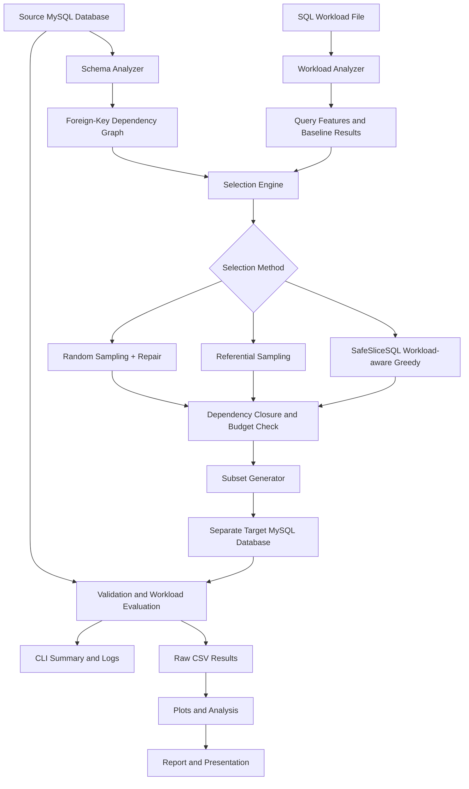

# SafeSliceSQL — Architecture

## System Overview

SafeSliceSQL creates smaller relational database subsets while preserving
referential integrity and retaining as much behavior as possible for a
declared SQL workload. It compares a proposed workload-aware selection
method against baseline sampling strategies under a defined row budget.

## High-Level Architecture



## Component Responsibilities

| Component | Responsibility | Owner |
|---|---|---|
| `config.py` | Environment and database configuration | M1 |
| `db.py` | Database connection management | M1 |
| `schema_analyzer.py` | Source schema introspection | M1 |
| `dependency_graph.py` | FK graph and dependency closure | M1 |
| `subset_generator.py` | Target database creation and population | M1 |
| `workload_analyzer.py` | SQL workload parsing and feature extraction | M2 |
| `sampler.py` | Row selection methods (baselines + proposed) | M2 |
| `validator.py` | Subset validation and workload evaluation | M3 |
| `benchmark.py` | Benchmark runner and experiment management | M3 |
| `cli.py` | Command-line interface | M3 |
| `reporting.py` | Result formatting and CSV export | M3 |

## Function Contracts

```python
inspect_schema(engine) -> SchemaMetadata
select_rows(schema, workload, budget, method, seed) -> SelectionResult
materialize_subset(engine, selection, target_database) -> GenerationResult
validate_subset(source, target) -> ValidationReport
evaluate_workload(source, target, workload) -> WorkloadReport
run_benchmark(config) -> BenchmarkResults
```

See `src/safeslicesql/types.py` for complete type definitions.

## Data Flow

1. **Configure** → Load `.env`, validate settings
2. **Inspect** → Schema analyzer reads MySQL metadata
3. **Analyze** → Workload analyzer parses SQL and records source results
4. **Build graph** → Dependency graph from FK relationships
5. **Select** → Method-specific row selection with closure
6. **Materialize** → Create target DB, insert in dependency order
7. **Validate** → Check PK/FK integrity, budget compliance
8. **Evaluate** → Run workload on source and target, compute metrics
9. **Report** → Save CSV results, generate plots
