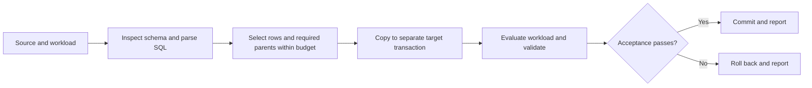

# Technical reference

[Quick start](../README.md) | [Operations](operations.md) | [Datasets](../datasets/README.md)

## Purpose and architecture

Given a source database, a supported SQL workload, a row budget, and a seed,
SafeSliceSQL selects rows plus their required parent records, creates a separate
copy, and measures how much declared query behavior survives. It is a heuristic
for database reduction, not a guarantee of equivalent answers or an optimal subset.

The desktop and terminal prepare input through `dataset_input.py` and experiment
settings through `experiment_config.py`. CLI runs and benchmarks share
`pipeline.run_pipeline`, which coordinates selection, copying, evaluation,
validation, acceptance, and timing.

- `config.py`, `db.py`, `runtime.py`: connections, credentials, bounded execution.
- `schema_analyzer.py`, `dependency_graph.py`: schema metadata and parent dependencies.
- `workload_analyzer.py`, `workload_candidates.py`, `sampler.py`: query parsing,
  workload witnesses, and row selection.
- `subset_generator.py`, `validator.py`, `source_snapshot.py`: materialization,
  integrity checks, workload comparisons, and source fingerprints.
- `benchmark.py`, `reporting.py`, `desktop.py`, `cli.py`: experiments, reports, and interfaces.

Implementation signatures and result types live in `src/safeslicesql/`, especially
`types.py`; this guide does not duplicate API signatures.

## Supported scope

- MySQL 8.x, InnoDB, and a declared primary key on every table. SQLite supports
  local tests; other database engines are outside the supported application scope.
- Single-column or composite primary keys; single-column foreign keys; acyclic
  cross-table dependencies. Self-referencing tables require acyclic row dependencies.
- A NULL foreign key means no dependency: its row can be selected without a parent.
- Fixed SELECT workloads with WHERE, explicit INNER JOIN, GROUP BY, HAVING, and
  basic COUNT/SUM/MIN/MAX/AVG aggregates, subject to parser validation.
- A hard total-row budget, including dependencies, and recorded random seeds.

Composite or cross-database foreign keys, cross-table cycles, and cyclic self-references
are unsupported. Unsupported SQL includes outer/comma joins, subqueries, CTEs,
set operations, window functions, DML/DDL, and parameterized/dynamic statements.
Database-qualified workload table names are excluded to prevent target evaluation
from referring back to a named source database.

Statement splitting respects quoted strings/identifiers and ordinary SQL/MySQL
comments. Executable comments and unterminated quotes/comments are rejected;
the lexer assumes MySQL backslash escapes. Treat application SQL as trusted input,
not as code isolated by a hostile-query sandbox.

## Budget and dependency closure

Dependencies are represented as parent-to-child graph edges. Selecting a child
requires recursively including its referenced parents. Only rows missing from the
current selection count toward incremental cost; a candidate is accepted only if
its full required closure fits. The CLI accepts 1-100% of exact source row counts,
rounds down, and uses a minimum budget of one row. Library budgets may be zero.
A valid subset may leave budget unused. Per-table, storage-based, and soft budgets
and incremental refresh are not implemented.

## Copy safety

Source and target identities must differ. MySQL checks use the connected server
UUID and database, including when host aliases are used. Existing target tables
must match columns, primary/foreign keys, unique/check constraints, and indexes;
unrelated tables and pre-existing target triggers are rejected before writes.

Compatible targets are refreshed with child-first deletes and parent-first inserts.
Self-referencing tables use row dependency order. Selected keys must be unique and
present in the source; generated columns are computed by the target. Inserted values
are compared against source batches, and the actual target row count is checked.
Evaluation, validation, and acceptance happen before the target transaction commits.
Failures restore previous target rows. MySQL DDL is not transactional; cleanup
attempts to drop only tables created by the failed attempt. See the operations
guide for cancellation, crash recovery, locking, and concurrent-writer boundaries.

## Selection methods

### Implemented heuristic

Workload-aware selection first obtains bounded primary-key witnesses using the
actual FROM/JOIN/WHERE conditions of each supported query. It visits witnesses
round-robin across queries, adding their required dependencies only when they fit.
Remaining sampled candidates are ranked by static table weights. Incremental
closure traversal skips previously selected dependencies and stops once the
remaining budget is exceeded. No standalone closure is computed for scoring.
HAVING thresholds and optimal marginal query-result gain are not solved; the
actual workload is evaluated before committing the target.

### Table weights

For each supported query without an analysis error, the implementation adds:

- 2.0 to every referenced table.
- 0.5 per detected join pair to the first referenced table.
- 1.0 per detected filter column to that column's table.
- 1.5 per detected grouping column to that column's table.
- 1.0 to the first referenced table when grouping or aggregation is present.

An otherwise unweighted table receives weight 1.0. Workload-aware selection
requires at least one usable supported query; missing or unusable workloads
are errors rather than a silent fallback to uniform weights.

### Selection procedure

1. Seed actual workload witnesses as described above, then sample candidates
   from each table. The proportional pool targets 1.25 times the budget, capped by source
   size; per-table rounding and a one-candidate minimum can increase this total.
2. Prefetch candidate foreign-key values; cache referenced unique-key lookups.
3. Use the table weight as a static score, shuffle with the recorded seed, then stably sort
   scores descending. The seeded shuffle resolves equal-score ties.
4. Visit candidates in that order. Skip rows already selected. Compute the
   incremental number of closure rows not yet in the selection.
5. Accept the candidate and dependencies only if that incremental cost fits
   the hard row budget. Reject candidates that do not fit.
6. Stop when the budget is full or all sampled candidates have been considered.

Incremental feasibility is recalculated at acceptance time; rankings and table
weights remain fixed. A rejected candidate is not revisited, so the result may
leave unused budget and has no optimality guarantee.

### Baselines

Random-repair shuffles the sampled candidates and applies the same closure and
budget checks. Referential selection visits tables in parent-first order and
shuffles candidates within each table. Neither baseline uses workload weights.

### Primary keys and reproducibility

Single-column primary keys use scalar values. Composite primary keys use tuples
in schema order. Live sampling orders by every primary-key column, so a fixed
seed is independent of the database's unordered scan plan on unchanged data.
Composite foreign-key constraints remain unsupported.

### Resource use

Candidate memory scales with the sampled pool and dependency closures, rather
than all source primary keys. Dense integer keys use uniform rejection sampling
with bounded indexed lookups. Sparse, textual and composite keys retain an exact
streaming reservoir scan. Ordering can require database work when an index
cannot satisfy the ordering. Scoring
sorts C candidates in O(C log C), in addition to traversal and database costs.

Standalone workload analysis can stream result rows to count them; pipeline
setup skips that redundant execution. Evaluation streams both
results into a temporary indexed SQLite store for exact multiset and distinct-key
comparisons. Python memory is bounded by a batch and individual row size;
temporary disk use scales with distinct result, key, and group tuples. The store
is closed and removed after each query, including failures.

## Metrics and evidence

### Workload accounting

Supported syntax and execution success are separate. Unsupported queries (including subqueries, CTEs, set operations, outer joins, and window functions) are excluded with a reason. Supported queries that fail on either database remain supported, carry an error, and receive zero retention scores. Runs containing workload execution errors are unsuccessful and are excluded from benchmark performance averages.

Query survival is the number of supported queries returning at least one row on both databases divided by the eligible source queries. Confirmed source-empty queries are excluded from this denominator. If source execution fails and no successful baseline establishes whether the source was empty, that query is conservatively included as a failed eligible query. Reports expose the denominator, known source-nonempty count, unknown-source count, and failed-query count.

### Retention

- **Result-row retention:** multiset intersection size divided by the number of source result rows. Duplicate tuples count up to their multiplicity in each result. All columns are preserved by ordinal position, including repeated output names. Values are compared with their driver-returned types; result ordering is ignored.
- **Key retention:** fraction of distinct source key tuples retained, using declared primary keys mapped through simple projections and aliases, or explicit projected grouping keys. Ambiguous projections fall back to result-row retention. Column-name suffixes do not identify keys.
- **Aggregate retention:** survival of distinct grouping-key combinations when every grouping expression can be mapped to a projected output position. Mapping handles column aliases and GROUP BY ordinals. It measures group survival, not numerical aggregate accuracy. For scalar aggregates or grouping expressions that cannot be mapped safely, the metric conservatively uses exact result-row retention; missing output columns never become artificial `None` group keys.
- **Empty/empty results:** retention scores are 1, while query survival is false and the query is excluded from the survival denominator. Retention averages include all supported queries, including these empty cases and execution failures (zero).

### Integrity and source verification

Validation checks table/column definitions, primary/foreign keys, unique/check constraints, actual target row count, and referential integrity. Required checks that cannot execute fail validation.

CLI runs and benchmarks capture a streaming content fingerprint during setup.
Each pipeline establishes a repeatable-read source transaction and verifies its
fingerprint against that baseline before target changes. Selection, copying and
evaluation use the same read view; final validation reuses that verified
fingerprint. It includes schema definitions, values, types and row multiplicities.
Source fingerprinting still requires full scans.

Standalone validation without a before-run content snapshot reports source immutability as **NOT VERIFIED** (`source_unchanged=None`). A row-count baseline can prove a change but cannot prove unchanged content. Structural validity can still pass with source history unverified. API callers can use `capture_source_snapshot(engine)` and pass the result as `initial_source_snapshot` to `validate_subset`.

Standalone fingerprints compare endpoint states; they do not prove absence of
intervening writes. Pipeline results describe the stable source read view, not
the absence of concurrent external writes. Avoid concurrent schema changes.

### Benchmark summaries

Raw results retain every attempted run and its failure details. Performance means and sample standard deviations use successful runs only; absent workload measurements remain missing rather than zero. Summaries include attempted/successful/failed counts and observation counts per metric. Groups with no successful measurements show N/A, and single-observation standard deviations are N/A. Charts omit missing/failed measurements rather than substituting zero.

Generated observations describe the measured values and ties. They do not assert predetermined winners or statistical superiority. Historical reports generated with older metric definitions must be regenerated before comparison with current results.

### Timing

Selection, materialization, validation, and workload evaluation have separate timings.
Initial baseline capture and source snapshot preflight are setup work outside
those stage timings. Materialization time excludes its nested evaluation and
validation steps to avoid double counting. Failed runs do not contribute
artificially short timings to successful-run means.

### Large query results

Analysis counts streamed result rows without retaining them. Evaluation uses
streamed reads and a temporary disk-backed index for exact row multiplicities,
keys, and grouping combinations. It needs temporary disk space proportional to
distinct result data. Query timings include execution and streaming; comparison
ingestion is recorded separately.
Temporary data is removed on success and failure; exhaustion of disk space is
reported as an evaluation failure, not silently truncated results.

### Per-query timings

Per-query `execution_time_source` and `execution_time_target` measure connection,
execution and result-fetch time on the client. They are not isolated server CPU
time. JSON encoding and temporary comparison-store insertion are recorded
separately as `comparison_time_source` and `comparison_time_target`.

## Practical limitations

- Metrics cover only the declared supported workload. Automatic queries probe
  structure, not business intent; large-result probes use ordered samples of at
  most 1,000 rows (or the configured result cap if lower).
- CSV/Excel imports store text and synthetic IDs; they do not infer relationships
  or original numeric/date types. Use a relational source when those semantics matter.
- Workload witnesses and table weights do not solve aggregate thresholds, HAVING,
  top-N preservation, or global query-coverage optimization. Acceptance evaluates
  the actual output and can reject a structurally valid selection.
- Source fingerprinting reads all values. Sparse/text/composite primary keys may
  require a full candidate scan; deep self-reference chains can require sequential
  lookups. A small output percentage does not imply a fast run.
- There is no data masking, incremental replication, or multi-user authorization
  service. Runtime limits and safety boundaries are detailed in the operations guide.

For evaluation, keep dataset, workload, budget, and seed matched across methods;
repeat seeds and report failures as well as successful measurements. Record the
runtime environment and use generated raw reports rather than historical numbers.
Synthetic scale evidence measures client resources, not MySQL server capacity or
concurrent-user performance. No fixed capacity or universal method superiority is claimed.

Possible extensions include composite foreign keys, broader SQL support, better
query-contribution estimates, incremental updates, and storage/per-table budgets.
These are future work, not implemented features.
