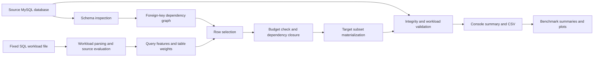

# SafeSliceSQL — Technical Project Report

> Historical reference. This document predates the current desktop/input flows,
> safety fixes, and metric definitions. Follow README.md for current setup and
> docs/metrics.md for current measurements; regenerate benchmark evidence.

## Purpose and audience

This report describes SafeSliceSQL based on the project documentation, current source code, and the completed 1% benchmark runs supplied in `C:\Users\prana\Downloads\results_safe_slice_sql.txt`. It is written as source material for a technical presentation. The reported experimental findings are limited to those three runs (same dataset, workload, budget, and seed); they do not establish general superiority across datasets or random seeds.

## Executive summary

SafeSliceSQL is a Python tool for creating smaller relational database subsets under a strict row-count budget. It targets a declared set of SQL `SELECT` queries and aims to retain useful query behavior while keeping selected foreign-key relationships valid. It compares three row-selection strategies—random sampling with dependency repair, referential/table-aware sampling, and the proposed workload-aware greedy strategy—and provides materialization, validation, workload evaluation, and benchmark reporting.

The key idea is to make database reduction more useful for a known workload than naive random selection, while accounting for the extra rows needed to preserve parent records. Workload retention is an optimization goal, not a guarantee of equivalence for arbitrary SQL or a globally optimal result.

## 1. Problem statement — why this project?

### The problem

Large production-like databases are expensive and inconvenient to copy in full for development, testing, demos, and experiments. A simple random sample can be smaller, but may remove records needed by joins, filters, and aggregates. Selecting child rows without their referenced parent rows can also break referential integrity. Thus, a subset can be small yet invalid, or valid yet unrepresentative of the queries that matter.

### Formal objective

Given:

- a source relational database and its schema;
- a fixed, supported SQL workload;
- a hard maximum number of rows; and
- a selection strategy and random seed,

select a smaller set of rows that respects the budget, preserves supported primary-key/foreign-key relationships, and retains as much behavior as possible for the declared workload.

### Why it matters

- Reduces the volume of data needed for repeatable development and test environments.
- Preserves useful join paths by carrying required parent rows along with selected child rows.
- Makes comparisons between sampling strategies measurable under the same budget.
- Provides explicit validation and exclusions rather than treating every schema or SQL pattern as supported.

### Problem boundaries

SafeSliceSQL is not a general-purpose database anonymization product, a query optimizer, or a guarantee of equivalent results for all possible queries. Workload quality is measured only against the supported queries supplied to the run. The project does not claim privacy protection or data masking.

## 2. Problem architecture — technical approach

### End-to-end architecture

### Processing pipeline

1. **Configure connections:** Read source/target database settings from environment configuration. The source and target must be distinct; materialization includes a safeguard against writing into the source database.
2. **Inspect schema:** Read tables, columns, primary keys, foreign keys, nullability, and row counts. Unsupported schema cases are recorded.
3. **Analyze workload:** Load SQL statements from a fixed workload file, extract tables, joins, filters, grouping columns, and aggregates, classify unsupported patterns, and—when connected to a source—execute queries to establish baseline results.
4. **Build dependency graph:** Represent foreign-key relationships as a directed parent-to-child graph. When a child row is selected, recursively include its required referenced parent rows. A `NULL` foreign key is treated as no dependency.
5. **Select rows:** Run one of three selectors with a configured hard row budget and seed.
6. **Materialize:** Create/refresh the separate target schema and insert selected rows in parent-before-child order, preserving original primary-key values. Inserts are batched; foreign-key checks are not intentionally disabled as a workaround.
7. **Validate and evaluate:** Check tables and columns, primary-key uniqueness, foreign-key violations, budget compliance, and workload behavior on source and target.
8. **Report:** Present console summaries and save run/benchmark metrics as CSV; benchmark code also produces summary output and can generate plots.

### Selection strategies

| Method | Technical approach | Role in evaluation |
|---|---|---|
| `random-repair` | Choose rows reproducibly, then add required parent rows and reject additions that exceed the budget. | Random baseline with referential repair. |
| `referential` | Select rows in a relationship-aware table order, expand dependency closure, and enforce the same budget. | Structural/table-aware baseline. |
| `workload-aware` | Build table weights from supported workload features, score candidate rows by table weight divided by standalone dependency-closure size, then accept candidates whose incremental closure fits the remaining budget. | Proposed heuristic. |

The workload-aware method assigns higher weight to tables appearing in supported queries and adds weight for joins, filters, and grouping/aggregate features. In the current implementation, the score is a **table-level workload-weight heuristic**, not a query-by-query calculation of each row’s actual marginal contribution to result retention. That distinction is important when describing the current implementation or interpreting future evaluation results.

### Hard budget and dependency closure

The budget is a maximum total selected row count across tables. For each candidate, the selector accounts for rows already selected and only charges additional rows in the candidate’s dependency closure. A candidate is skipped when its closure would exceed the remaining budget. This prioritizes budget correctness over filling every available row.

### Evaluation measures

The validator and benchmark data structures track:

- **Integrity/correctness:** primary-key uniqueness, foreign-key violations, schema/table compatibility, source row-count check, and hard-budget compliance.
- **Workload behavior:** whether supported queries remain non-empty, result-row retention, key retention, aggregate/group retention, and per-query execution times.
- **Cost/size:** selected and inserted row counts, dependency-closure additions, rejected candidates, phase runtimes, and optional storage measurements.

Metric definitions and supported-query accounting should be kept consistent with the code and experiment configuration. Report actual values only from completed runs, with the dataset, workload, budget, seed, and method stated.

## 3. Challenges addressed by the design

The repository does not document a verified diary of team-specific incidents. The following are therefore best presented as **technical challenges the project addresses**, rather than claims about particular historical events.

| Challenge | Design response | Remaining caveat |
|---|---|---|
| Random subsets can break foreign-key relationships. | Model foreign keys as a dependency graph and add required parent rows through closure. | Supported graph scope is limited; cyclic dependencies are not supported in v1. |
| Referential repair can make a sample exceed its size limit. | Calculate incremental closure cost and reject candidates that do not fit the hard row budget. | A valid selection may leave some budget unused. |
| Database schemas differ and may contain unsupported structures. | Introspect schema metadata and report unsupported features such as composite foreign keys and cycles. | Detection does not mean those structures are handled by selection/materialization. |
| Rows that matter to queries may be missed by uniform random sampling. | Extract workload features and bias candidate ranking toward workload-relevant tables. | Current scoring uses table-level weights, not exact row-level workload value. |
| Parent/child insertion order matters when foreign keys are enforced. | Topologically order tables and insert parents before children. | Requires an acyclic supported dependency graph. |
| Comparisons are unreliable if methods use different conditions. | Share selection interface, budget handling, materialization, validation, and benchmark matrix settings; seeds are configurable. | Fairness still depends on using matched datasets/workloads and reporting configurations accurately. |
| A smaller database can appear valid but lose query behavior. | Compare workload outcomes on source and target and report query survival/retention metrics. | Results cover only the declared and supported workload. |

## 4. Features and shortcomings

### Implemented features

- Schema introspection and foreign-key graph construction.
- Support for single-column and composite primary keys.
- Support for single-column foreign keys on acyclic graphs; nullable foreign keys mean no parent dependency.
- Three reproducible row-selection methods: `random-repair`, `referential`, and `workload-aware`.
- Hard total-row-budget enforcement and dependency-aware candidate acceptance.
- Separate target-database materialization with original key values and parent-first table ordering.
- Validation for table/column compatibility, primary-key uniqueness, orphan references, and row-budget compliance.
- Parsing/classification of a fixed SQL workload and evaluation of supported queries on source and target.
- CLI commands for schema inspection, subsetting, validation, and benchmarking.
- CSV result export and benchmark aggregation/plotting support.
- Unit/integration-style test coverage, including SQLite-backed tests; MySQL is the documented production target.

### Current supported scope

The documented v1 target is MySQL 8.x with InnoDB. The workload scope is read-only `SELECT` queries using supported patterns such as `WHERE`, inner joins, `GROUP BY`, `HAVING`, and basic aggregates. Exact details should be checked against the parser’s current supported-pattern rules before using a particular query in a demonstration.

### Shortcomings and limitations

- The greedy selector is heuristic and does not guarantee a globally optimal subset.
- Workload-aware scoring is based on table-level weights and dependency cost; it does not compute exact row-level query-result marginal value.
- The result is workload-specific. Undeclared queries may behave poorly on the subset.
- Composite foreign keys, cyclic foreign-key graphs, outer joins, subqueries, CTEs, set operations, window functions, DML, and dynamic/parameterized SQL are outside the documented v1 scope.
- Per-table budgets, storage-based budgets, soft budgets, cross-database foreign keys, and incremental subset updates are not implemented.
- The benchmark examples include SQLite URLs for local example runs; production MySQL experiments require an appropriate MySQL setup/configuration.
- The supplied results cover one database, one 1% budget, and one seed; they are not enough to establish statistical significance or general performance across datasets.

## 5. Experimental evaluation — 1% subset results

### Experimental setup

The supplied console log records three successful runs against the MySQL `employees` database. Each run used the same fixed workload (`workloads/workload.sql`), seed `42`, and a hard budget of **39,190 rows**, equal to 1% of the reported 3,919,015 source rows. All three runs selected and materialized exactly 39,190 rows. The workload contained 8 supported queries and excluded none. These are results from one seed and one database, so treat them as a controlled example, not a statistically conclusive comparison.

### Overall results

| Algorithm | Target database | Query survival | Key retention | Row retention | Aggregate retention | Closure additions | Rejected candidates | Validation |
|---|---|---:|---:|---:|---:|---:|---:|---|
| Random sampling + repair (`random-repair`) | `employees_random_1pct` | 75.0% | 13.5% | 13.2% | 38.5% | 18,506 | 0 | Passed |
| Referential/table-aware (`referential`) | `employees_referential_1pct` | 62.5% | 13.6% | 13.4% | 38.6% | 17,357 | 15 | Passed |
| Workload-aware greedy (`workload-aware`) | `employees_workload_1pct` | 75.0% | 13.7% | 13.5% | 38.7% | 17,352 | 17 | Passed |

**Interpretation:** In this one run, workload-aware tied random-repair for query survival and had the highest reported average key, row, and aggregate retention, but the differences in those averages were small. Referential sampling had lower query survival in this run, while its key and row retention averages were close to the other methods. Do not conclude that one method always wins from a single seed. The algorithms also retained different individual queries, so the aggregate averages do not tell the whole story.

All three validation summaries reported: budget passed at 39,190/39,190 rows; primary keys unique; zero foreign-key violations; source schema reproduced; and source database unchanged. Thus, workload-retention differences here were measured among subsets that passed the reported structural and budget checks.

### Per-query results

Each workload statement is assigned an ID by its order in `workloads/workload.sql`. The table below gives the query’s purpose and whether it returned any rows in each subset.

| Query ID | Workload query | Random-repair | Referential | Workload-aware |
|---|---|---:|---:|---:|
| Q1 | Employees hired after `1995-01-01` (filter) | YES | YES | YES |
| Q2 | Employee counts by gender (`GROUP BY`) | YES | YES | YES |
| Q3 | Current employee/department assignments (joins and date filter) | YES | YES | YES |
| Q4 | Current Senior Engineers (joins and filters) | YES | NO | YES |
| Q5 | Employee counts per department (join and `GROUP BY`) | YES | YES | YES |
| Q6 | Employees whose maximum salary exceeds 100,000 (`GROUP BY`/`HAVING`) | YES | YES | YES |
| Q7 | Current department managers (join chain) | NO | NO | NO |
| Q8 | Intentionally empty result (`emp_no = -1`) | NO | NO | NO |

Per-query metric detail is shown as **Key / Row / Aggregate retention**. Percentages are those printed by each run (rounded to one decimal place).

| Query | Random-repair K/R/A | Referential K/R/A | Workload-aware K/R/A |
|---|---:|---:|---:|
| Q1 | 4.3 / 4.3 / 4.3% | 5.1 / 5.1 / 5.1% | 5.4 / 5.4 / 5.4% |
| Q2 | 0.0 / 0.0 / 100.0% | 0.0 / 0.0 / 100.0% | 0.0 / 0.0 / 100.0% |
| Q3 | 0.5 / 0.5 / 0.5% | 1.2 / 1.2 / 1.2% | 1.2 / 1.2 / 1.2% |
| Q4 | 0.5 / 0.5 / 0.5% | 0.0 / 0.0 / 0.0% | 1.3 / 1.3 / 1.3% |
| Q5 | 0.0 / 0.0 / 100.0% | 0.0 / 0.0 / 100.0% | 0.0 / 0.0 / 100.0% |
| Q6 | 2.5 / 0.5 / 2.5% | 2.3 / 0.5 / 2.3% | 1.3 / 0.3 / 1.3% |
| Q7 | 0.0 / 0.0 / 0.0% | 0.0 / 0.0 / 0.0% | 0.0 / 0.0 / 0.0% |
| Q8 | 100.0 / 100.0 / 100.0% | 100.0 / 100.0 / 100.0% | 100.0 / 100.0 / 100.0% |

For example, Q6 shows that workload-aware returned only a small fraction of the source keys and exact result rows, while Q2/Q5 retained the grouping categories but not the exact output tuples/aggregate values under the current metrics.

Q8 is deliberately empty on the source as well as the subsets. Its `Survived = NO` does **not** mean the subset lost a source result: the survival flag requires both source and target results to be non-empty. Its retention metrics are shown as 100% by the current implementation because both result sets are empty. Q7 is a genuine loss in all three runs: it returns 9 rows on the source and zero rows in every subset.

### What the evaluation columns mean

- **Query ID / “question”:** `Q1`–`Q8` are labels for the eight SQL workload statements, not natural-language questions or separate benchmark runs. Their meanings are listed above and in `workloads/workload.sql`.
- **Source Rows:** Number of result rows returned by executing that query on the original `employees` database.
- **Target Rows:** Number of result rows returned by the same query on the generated subset. This is a count, not necessarily a count of exactly matching rows.
- **Survived:** `YES` means the query returned at least one row on both source and subset; `NO` means it did not. The summary rate in the current implementation divides the number of `YES` supported queries by **all supported queries**. Here that is 8, including empty-source Q8. So 6/8 = 75% for random-repair and workload-aware, and 5/8 = 62.5% for referential. If the presentation instead asks “of the seven queries that were non-empty on the source, how many remained non-empty?”, the corresponding rates are 6/7 = 85.7% and 5/7 = 71.4%. State the denominator whenever quoting survival.
- **Key Ret. (key retention):** Fraction of distinct source result keys also found in target results, using columns recognized as identifiers (for example `emp_no` or `dept_no`); if no such column is recognized, it falls back to exact result-row overlap. This is key coverage, not database primary-key integrity. It can be 0% even when a query survives.
- **Row Ret. (result-row retention):** Fraction of source result rows whose complete output tuples exactly match rows returned by the subset query. Query results can differ because selected records change joined rows or aggregate values. This metric is not simply `Target Rows / Source Rows`.
- **Agg Ret. (aggregate retention):** For grouped/aggregate queries, the implementation checks how many source grouping-key combinations still occur in target results. It is **not a comparison of aggregate values** such as `COUNT`, `SUM`, or `MAX`. For queries without grouping/aggregation, it defaults to row retention. Therefore Q2 and Q5 can show 100% Agg Ret. (their groups remain present) even though Key Ret./Row Ret. are 0% (their exact result rows/count values do not match).
- **Overall metric percentages:** The displayed averages are arithmetic means of the per-query metric values over all 8 supported queries. The current implementation includes Q8’s empty-source case as 100% retention, while its survival is NO. This makes the retention averages higher than they would be if empty-source queries were excluded; it is an implementation/metric-definition caveat to explain in the presentation.
- **Closure additions:** Additional parent/dependency rows needed to make selected rows referentially complete, as reported by the selector. These are not extra rows beyond the 39,190 budget; they are counted within it.
- **Rejected candidates:** Candidate rows not added because their required closure would exceed the remaining budget.

### Results interpretation and caveats

At the same 1% size, the workload-aware run achieved the best **reported** average retentions by a narrow margin and matched random-repair on the printed survival rate. Its per-query table shows Q4 survived, while it did not for referential sampling; however, Q7 was lost by all methods. These results suggest that workload-guided selection can help retain some declared query behavior, but this single seed does not prove a consistent advantage. For stronger evidence, repeat across multiple seeds and databases, and clarify the empty-query denominator and aggregate-value metric before making broad conclusions.

## 6. Conclusion and future approach

### Conclusion

SafeSliceSQL combines workload-guided sampling with relational dependency handling under an explicit row budget. Its main engineering contribution is an end-to-end, testable pipeline that connects schema analysis, dependency closure, several comparable selectors, safe subset materialization, integrity validation, workload evaluation, and reproducible result reporting. It addresses the tension between reducing data volume and retaining useful behavior for a known SQL workload, while making its support boundaries explicit.

The supplied single-seed evaluation demonstrates that all three methods can materialize a 1% subset that passes the reported integrity and budget validation. Workload-aware achieved the highest reported key, row, and aggregate retention averages by small margins and tied random-repair on the printed survival rate; it did not preserve every query, and all methods lost Q7. These findings are specific to this `employees` workload, budget, and seed and should not be presented as proof of general superiority.

### Recommended future work

1. **Improve workload value estimation:** Replace or augment table-level weights with query-aware row/tuple contributions, such as tracking query coverage and marginal result/key/aggregate retention while selecting candidates.
2. **Run and publish controlled evaluations:** Use matched data, methods, budgets, and seeds; save raw CSV results; compare all retention metrics and runtimes; include repeated runs and variance. Do not rely on prewritten benchmark observations unless reproduced.
3. **Expand schema support:** Add composite foreign keys and cycles, with explicit closure and materialization strategies for each.
4. **Expand SQL coverage:** Add outer joins, subqueries, and CTEs using a robust SQL parser and an explicit semantics/metric policy.
5. **Add practical controls:** Implement per-table/storage budgets, soft budgets, and incremental subset refresh where needed.
6. **Strengthen production readiness:** Test against multiple real MySQL schemas, improve large-result streaming and workload scaling, add operational safeguards/observability, and document permissions and repeatable setup.
7. **Clarify and validate metrics:** Specify exact matching and denominator rules for query survival, result rows, keys, and aggregates; add tests for empty-source queries and aggregate tolerance.

## Suggested presentation outline

This outline maps the report to the requested presentation sections and provides a practical 9-slide structure.

1. **Title and motivation** — SafeSliceSQL; database reduction for development/testing without losing important relational and workload behavior.
2. **Problem statement** — Full database copies are costly; naive sampling loses join/filter/aggregate coverage or breaks relationships.
3. **Objective and scope** — Input (database, workload, budget, seed), output (validated subset and evaluation); clearly state v1 scope.
4. **Architecture** — Use the pipeline diagram: inspect → analyze workload → graph/selection → closure/budget → materialize → validate/evaluate → report.
5. **Selection methods** — Explain three methods and why matched baselines are needed.
6. **Technical approach and safeguards** — Dependency closure, hard row budget, parent-first insertion, separate target, validation checks.
7. **Challenges addressed and solutions** — Use the challenge table; label as design challenges unless the team can verify specific incidents.
8. **Features, shortcomings, and measured results** — Show the three-algorithm 1% results and validation; define survival, key/row/aggregate retention and the empty-Q8 caveat.
9. **Conclusion and future work** — State findings as single-seed results, not proof of superiority; prioritize multi-seed tests and clearer metric definitions.

### Presentation wording to keep accurate

- Say **“workload-aware heuristic”**, not “optimal sampler.”
- Say **“preserves supported foreign-key integrity”**, not “supports every relational schema.”
- Say **“evaluates the declared supported workload”**, not “preserves all queries.”
- Use **measured benchmark results** for any superiority claim; configuration files or generated report templates are not evidence of a completed experiment.

## Source references

This report is based on the repository README, `docs/architecture.md`, `docs/algorithm.md`, `docs/limitations.md`, `docs/metrics.md`, the current implementation in `src/safeslicesql/` (especially `schema_analyzer.py`, `dependency_graph.py`, `workload_analyzer.py`, `sampler.py`, `subset_generator.py`, `validator.py`, `benchmark.py`, and `reporting.py`), the query definitions in `workloads/workload.sql`, and the supplied run log `C:\Users\prana\Downloads\results_safe_slice_sql.txt`.